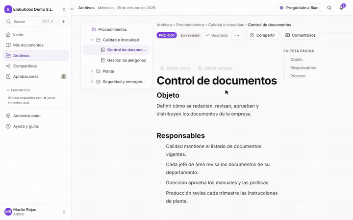
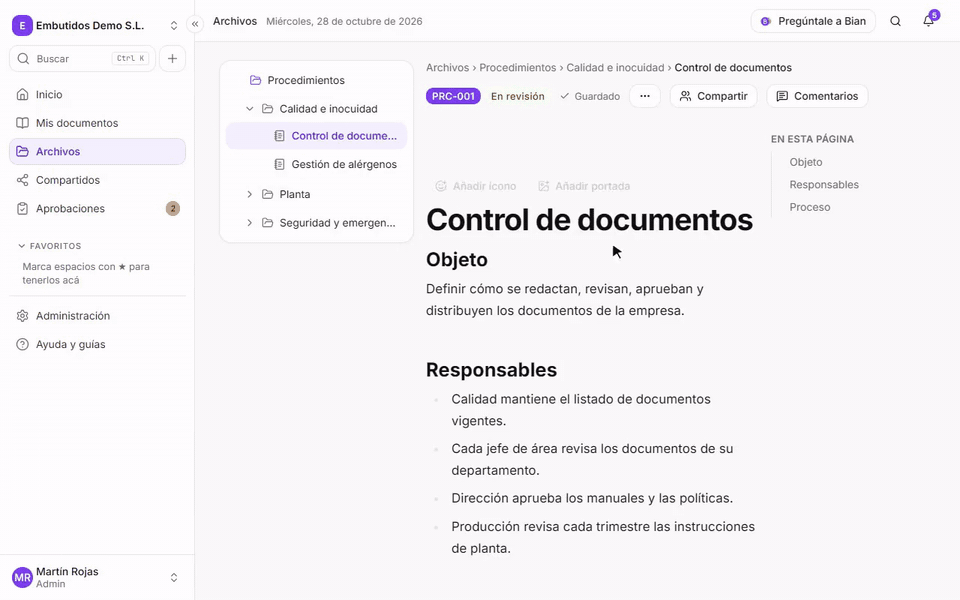
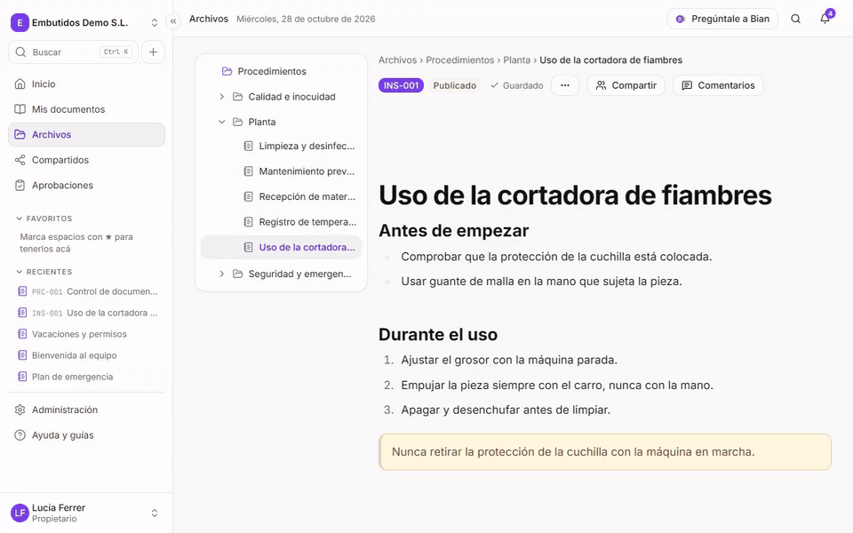
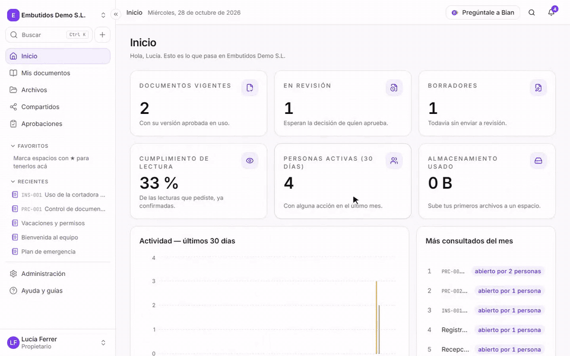
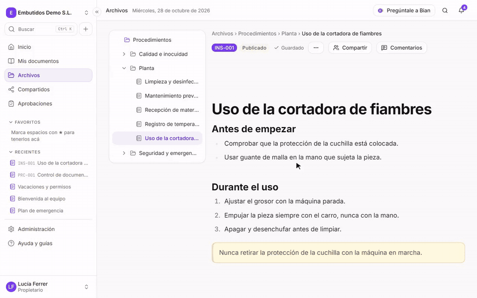

<p align="center">
  
</p>

<p align="center"><a href="README.md">English version: README.md</a></p>

<p align="center">
  <strong>La documentación interna de tu empresa, ordenada y en tu propio servidor.</strong><br>
  <strong>SpiderFolio es un sistema open source y autoalojado de documentación interna y gestión
  documental (wiki + biblioteca de archivos + documentos controlados) para pequeñas y medianas
  empresas, incluidas fábricas y talleres. AGPLv3, Docker Compose, español e inglés.</strong><br>
  Páginas, archivos y documentos controlados con permisos que se entienden. Open source (AGPLv3).
</p>

<p align="center">
  <a href="docs/instalacion/README.md">Instalar</a> ·
  <a href="https://spiderfolio.spiderjad.com/docs">Documentación</a> ·
  <a href="https://spiderfolio.spiderjad.com/plugins">Plugins</a> ·
  <a href="CONTRIBUTING.md">Contribuir</a>
</p>



## Funciones

### Documentos controlados

Historial de versiones, qué cambió entre dos versiones, la aprobación y el PDF controlado con su marca
de agua.



### Códigos QR para la planta

Generas el QR de un documento: al escanearlo, abre siempre la versión vigente.



### Bian, el asistente IA

Responde con los documentos vigentes que cada persona puede ver y cita la fuente.



### Quién accede y por qué

Cada documento explica quién puede entrar y por qué motivo.



## Qué es

SpiderFolio reemplaza el caos de carpetas compartidas por un lugar donde cada persona ve lo que le
corresponde. Pensado para pymes de habla hispana, también en planta.

- **Páginas tipo Notion y biblioteca de archivos** con espacios, carpetas, versiones y búsqueda de
  texto completo (también dentro de PDF y Word).
- **Permisos por departamentos y roles** que se explican: cada carpeta, archivo y página muestra quién
  accede y por qué.
- **Documentos controlados**: código, una única versión vigente, aprobaciones, confirmación de lectura,
  PDF controlado y auditoría exportable.
- **Para la planta**: códigos QR que abren siempre la versión vigente, vencimientos y una vista simple
  para tablets con usuario y PIN.
- **Bian, el asistente IA**: responde solo con el contenido vigente que cada persona puede ver y cita la
  fuente. Usa tu propia clave de la API de Anthropic.
- **Seguridad**: verificación en dos pasos, sesiones y dispositivos de confianza, registro de auditoría
  y aislamiento estricto entre empresas.
- **En español y en inglés**: cada persona elige su idioma; la empresa fija el idioma por defecto.

|                                             |                                                                 |
| ------------------------------------------- | --------------------------------------------------------------- |
|  |  |
|      |                                  |

## Instalar

Con Docker Compose. Elige dónde lo vas a instalar; cada opción tiene su paso a paso completo en la
[guía de instalación](docs/instalacion/README.md):

| Opción | Para qué | Guía |
| --- | --- | --- |
| Probar en tu PC | Verlo funcionando (Windows, macOS o Linux), con una bandeja de email de prueba | [Probar en tu PC](docs/instalacion/README.md#probar-en-tu-pc) |
| Servidor con dominio propio | Uso real, con HTTPS automático | [Servidor con dominio propio](docs/instalacion/README.md#servidor-con-dominio-propio) |
| Servidor con proxy propio | Ya tienes nginx, Traefik, IIS… | [Servidor con proxy propio](docs/instalacion/README.md#servidor-con-proxy-propio) |

Windows Server: lo recomendado es una máquina virtual Ubuntu en Hyper-V
([Windows](docs/instalacion/README.md#windows)).

Estos comandos descargan el paquete de instalación de la última Release. El script de instalación
pregunta lo mínimo, genera los secretos y escribe `.env`.

**Windows (PowerShell)**, con Docker Desktop en marcha:

```powershell
cd $HOME
$url = "https://github.com/spiderjad/SpiderFolio" +
  "/releases/latest/download/spiderfolio-deploy.zip"
Invoke-WebRequest $url -OutFile spiderfolio.zip
Expand-Archive spiderfolio.zip -DestinationPath .
cd spiderfolio
powershell -ExecutionPolicy Bypass -File .\setup.ps1
docker compose up -d
```

**Linux**:

```sh
url=https://github.com/spiderjad/SpiderFolio
url=$url/releases/latest/download/spiderfolio-deploy.tar.gz
curl -fsSL $url | tar -xz
cd spiderfolio
./setup.sh
docker compose up -d
```

Comprueba: `curl http://localhost:8080/api/health` responde `{"status":"ok"}`. Después abre la
dirección que elegiste (en tu PC, `http://localhost:8080`; los emails de prueba, en
`http://localhost:8025`).

Más: [email (SMTP)](docs/instalacion/email.md), [actualizar](docs/instalacion/actualizar.md), [copias de seguridad](docs/instalacion/copias-de-seguridad.md)
y la [guía en la web](https://spiderfolio.spiderjad.com/es/docs/instalar). In English:
[docs/install](docs/install/README.md).

## Plugins comerciales

El núcleo es completo y gratuito. Algunas funciones para empresas se ofrecen como plugins que se
activan con una licencia verificada sin conexión: políticas de seguridad avanzadas (exigir 2FA,
dominios permitidos, SSO), importación desde OneDrive y SharePoint, conector MCP para Claude, plantillas
por rubro y salas de auditoría. Sin licencia, SpiderFolio funciona igual. Ver
[docs/spec/plugins.md](docs/spec/plugins.md) y la página [Plugins](https://spiderfolio.spiderjad.com/plugins).

## Desarrollo

Requisitos: Node 24 (`.nvmrc`), npm 11 y Docker.

```sh
cp .env.example .env          # completa JWT_ACCESS_SECRET, S3_ACCESS_KEY, S3_SECRET_KEY y SEED_DEMO_PASSWORD
docker compose up -d          # postgres, mailpit, rustfs, gotenberg
npm install
npm run db:migrate
npm run db:seed               # empresa demo «Embutidos Demo S.L.» (usuarios @demo.local)
npm run dev                   # API :4000 + worker + app :5173 + web :4321
```

| Comando                    | Qué hace                                                                   |
| -------------------------- | -------------------------------------------------------------------------- |
| `npm run typecheck`        | TypeScript en la raíz y en cada workspace                                  |
| `npm run lint`             | ESLint, sin advertencias                                                   |
| `npm run test`             | Tests unitarios                                                            |
| `npm run test:integration` | Tests con Postgres y Mailpit reales (`docker compose up -d`)               |
| `npm run check:secrets`    | Ningún secreto en los archivos versionados (también en el hook y en el CI) |

Estructura, reglas y especificación: [CLAUDE.md](CLAUDE.md) y [docs/spec/](docs/spec/). Para
contribuir: [CONTRIBUTING.md](CONTRIBUTING.md) (requiere aceptar el [CLA](CLA.es.md)).

## Licencia

Copyright (C) 2026 Diego Pennisi. SpiderFolio se distribuye bajo la [GNU Affero General Public License v3.0](LICENSE). Si ofreces una
versión modificada a otras personas a través de una red, tienes que ofrecerles también su código fuente.
Licencias de las dependencias: [docs/licencias-dependencias.md](docs/licencias-dependencias.md).

Vulnerabilidades: [SECURITY.md](SECURITY.md). Conducta: [CODE_OF_CONDUCT.md](CODE_OF_CONDUCT.md).

## Casos de uso

- **Dejar las carpetas compartidas**: lleva los documentos de un servidor de archivos o una unidad
  compartida a espacios y carpetas, subiendo carpetas o importando un ZIP que conserva su estructura. El
  acceso se da por departamentos, así sigue a las personas cuando cambian de equipo.
- **Control de documentos**: procedimientos e instructivos con código (PRC-001…), aprobaciones antes de
  publicar, una única versión vigente, fecha de próxima revisión, PDF controlado y auditoría exportable.
- **Lecturas obligatorias**: pide a departamentos o personas que lean un documento vigente y lo
  confirmen, con fecha límite, recordatorios automáticos y un cumplimiento que se exporta a CSV.
- **La planta**: un código QR junto a una máquina abre siempre la versión vigente de su instructivo. Los
  operarios pueden entrar en una tablet compartida con usuario y PIN y ver lo que tienen que leer.
- **Wiki interna**: páginas tipo Notion para el saber hacer, la incorporación de personas y las
  políticas, con comentarios y menciones, junto a los archivos a los que se refieren.
- **Preguntas sobre tus documentos**: con Bian activado, las personas preguntan con sus palabras y
  reciben respuestas solo con el contenido vigente que pueden ver, con la fuente.
- **Varias empresas en un servidor**: una instalación puede alojar varias empresas, cada una con sus
  datos aislados.

## Preguntas frecuentes

### ¿Es gratis?

Sí. El núcleo es completo y gratuito bajo la AGPLv3, sin planes ni precios por persona. Algunas
funciones para empresas son plugins comerciales opcionales; sin ellos SpiderFolio funciona igual.

### ¿Qué necesito para instalarlo?

Docker Compose. Para uso real, un servidor Linux con 2 vCPU y 4 GB de RAM para hasta unas 200 personas,
un dominio (o tu propio proxy con HTTPS) y un servidor de email (SMTP). Ver la
[guía de instalación](docs/instalacion/README.md).

### ¿Puedo usar Windows?

Para probarlo, sí: Docker Desktop en Windows 10/11 con el script de instalación de PowerShell. Para un
servidor que funcione 24/7 con Windows Server, la guía recomienda una máquina virtual Ubuntu en Hyper-V.

### ¿Dónde quedan mis datos?

En tu servidor: la base PostgreSQL y los archivos en su disco, o en el bucket compatible con S3 que
elijas (S3, R2, MinIO…).

### ¿Necesito un servidor de email?

Sí, para enviar verificaciones, invitaciones y avisos. Para probarlo en tu PC, el perfil `mail` agrega
una bandeja de prueba (Mailpit) y no hace falta. Ver [email (SMTP)](docs/instalacion/email.md).

### ¿El asistente IA es obligatorio?

No. Bian viene desactivado. Si lo activas, usa tu propia clave de la API de Anthropic, y cada empresa
fija su total mensual y los límites por persona.

### ¿Hay límites de usuarios o de espacio?

Por defecto, ninguno. Cada empresa puede fijar sus propios límites (almacenamiento, tamaño de archivo,
versiones guardadas, retención de la auditoría) en Administración › Límites y uso.

### ¿En qué idiomas está?

Español e inglés. Cada persona elige su idioma y la empresa fija el idioma por defecto.

### ¿Cómo hago copias y actualizo?

`backup.sh` (Linux) o `backup.ps1` (Windows) guardan la base, los archivos y el `.env`; `restore.sh` o
`restore.ps1` los recuperan. Para actualizar, se descarga el paquete de la nueva versión y se ejecutan
`docker compose pull` y `docker compose up -d`; las migraciones se aplican solas. Ver
[copias de seguridad](docs/instalacion/copias-de-seguridad.md) y [actualizar](docs/instalacion/actualizar.md).
