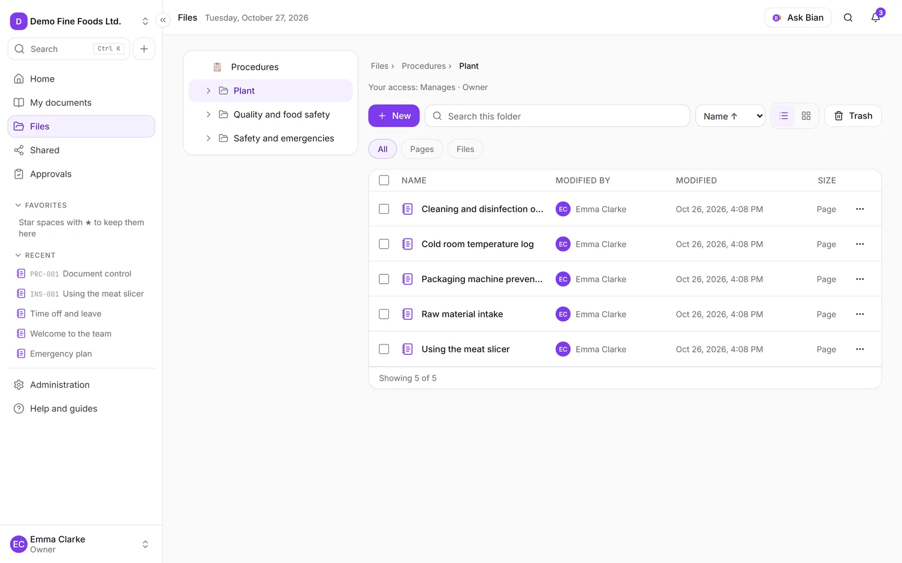
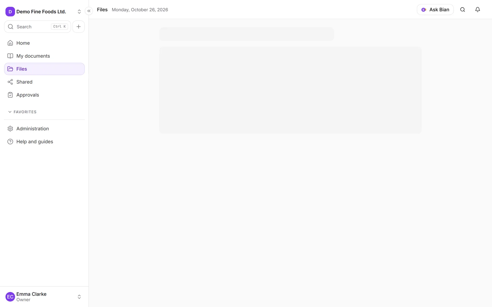
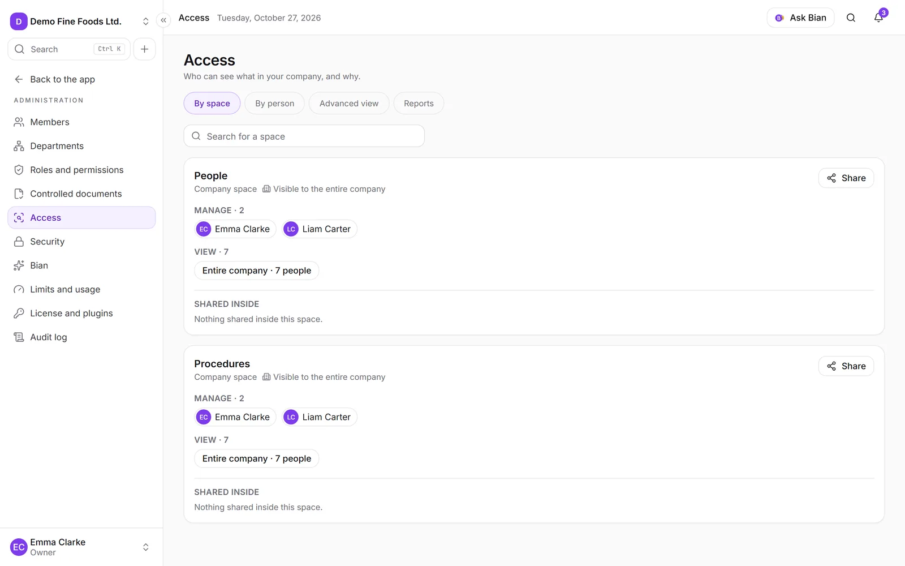
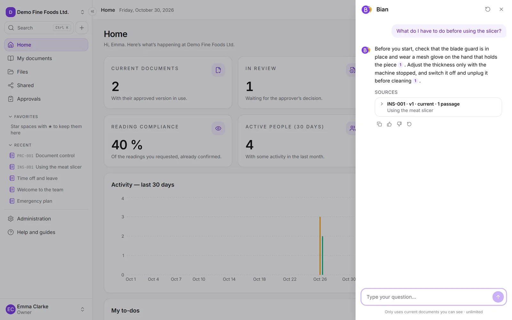

<p align="center">
  
</p>

<p align="center"><a href="README.es.md">Leer en español</a></p>

<p align="center">
  <strong>Your company's internal documentation, organized and on your own server.</strong><br>
  <strong>SpiderFolio is an open-source, self-hosted internal documentation and document management
  system (wiki + file library + controlled documents) for small and mid-sized businesses, including
  factories and workshops. AGPLv3, Docker Compose, English and Spanish.</strong><br>
  Pages, files and controlled documents with permissions that make sense. Open source (AGPLv3).
</p>

<p align="center">
  <a href="docs/install/README.md">Install</a> ·
  <a href="https://spiderfolio.spiderjad.com/docs">Documentation</a> ·
  <a href="https://spiderfolio.spiderjad.com/plugins">Plugins</a> ·
  <a href="CONTRIBUTING.md">Contribute</a>
</p>


## Features

### Controlled documents

Version history, what changed between two versions, the approval and the controlled PDF with its
watermark.


### QR codes for the shop floor

Generate a document's QR code: scanned, it always opens the current version.


### Bian, the AI assistant

It answers from the current documents each person can see, and cites the source.


### Who has access and why

Every document explains who can get in and for what reason.


## What it is

SpiderFolio replaces the chaos of shared folders with a place where each person sees what is meant
for them. Designed for small and mid-sized businesses in Spanish-speaking markets, including the shop
floor.

- **Notion-style pages and a file library** with spaces, folders, versions and full-text search (also
  inside PDF and Word files).
- **Permissions by department and role** that explain themselves: every folder, file and page shows
  who has access and why.
- **Controlled documents**: document code, a single current version, approvals, read confirmation,
  controlled PDF and an exportable audit log.
- **For the shop floor**: QR codes that always open the current version, expiry dates and a simple view
  for tablets with username and PIN.
- **Bian, the AI assistant**: answers only from the current content each person is allowed to see, and
  cites the source. Uses your own Anthropic API key.
- **Security**: two-step verification, sessions and trusted devices, audit log and strict isolation
  between companies.
- **In Spanish and English**: each person picks their language; the company sets the default one.

|                                                                |                                                                                |
| -------------------------------------------------------------- | ------------------------------------------------------------------------------ |
|  |  |
|       |                                 |

## Install

With Docker Compose. Pick where you'll install it; each option has its own complete step by step in
the [installation guide](docs/install/README.md):

| Option                       | What for                                                    | Guide                                                                               |
| ---------------------------- | ----------------------------------------------------------- | ----------------------------------------------------------------------------------- |
| Try it on your PC            | See it working (Windows, macOS or Linux), with a test inbox | [Try it on your PC](docs/install/README.md#try-it-on-your-pc)                       |
| Server with your own domain  | Real use, with automatic HTTPS                              | [Server with your own domain](docs/install/README.md#server-with-your-own-domain)   |
| Server behind your own proxy | You already have nginx, Traefik, IIS…                       | [Server behind your own proxy](docs/install/README.md#server-behind-your-own-proxy) |

Windows Server: an Ubuntu virtual machine in Hyper-V is recommended
([Windows](docs/install/README.md#windows)).

These commands download the installation bundle of the latest Release. The setup script asks the
minimum, generates the secrets and writes `.env`.

**Windows (PowerShell)**, with Docker Desktop running:

```powershell
cd $HOME
$url = "https://github.com/spiderjad/SpiderFolio" +
  "/releases/latest/download/spiderfolio-deploy.zip"
Invoke-WebRequest $url -OutFile spiderfolio.zip
Expand-Archive spiderfolio.zip -DestinationPath .
cd spiderfolio
powershell -ExecutionPolicy Bypass -File .\setup.ps1
docker compose up -d
```

**Linux**:

```sh
url=https://github.com/spiderjad/SpiderFolio
url=$url/releases/latest/download/spiderfolio-deploy.tar.gz
curl -fsSL $url | tar -xz
cd spiderfolio
./setup.sh
docker compose up -d
```

Check: `curl http://localhost:8080/api/health` answers `{"status":"ok"}`. Then open the address
you chose (on your PC, `http://localhost:8080`; test emails at `http://localhost:8025`).

More: [email (SMTP)](docs/install/email.md), [updating](docs/install/upgrading.md), [backups](docs/install/backups.md) and the
[web guide](https://spiderfolio.spiderjad.com/en/docs/install). In Spanish:
[docs/instalacion](docs/instalacion/README.md).

## Commercial plugins

The core is complete and free. Some business features are offered as plugins that are activated with
a license verified offline: advanced security policies (require 2FA, allowed domains, SSO), import from
OneDrive and SharePoint, an MCP connector for Claude, industry templates and audit rooms. Without a
license, SpiderFolio works just the same. See [docs/spec/plugins.md](docs/spec/plugins.md) and the
[Plugins](https://spiderfolio.spiderjad.com/plugins) page.

## Development

Requirements: Node 24 (`.nvmrc`), npm 11 and Docker.

```sh
cp .env.example .env          # fill in JWT_ACCESS_SECRET, S3_ACCESS_KEY, S3_SECRET_KEY and SEED_DEMO_PASSWORD
docker compose up -d          # postgres, mailpit, rustfs, gotenberg
npm install
npm run db:migrate
npm run db:seed               # demo company "Embutidos Demo S.L." (@demo.local users)
npm run dev                   # API :4000 + worker + app :5173 + web :4321
```

| Command                    | What it does                                                     |
| -------------------------- | ---------------------------------------------------------------- |
| `npm run typecheck`        | TypeScript at the root and in every workspace                    |
| `npm run lint`             | ESLint, no warnings allowed                                      |
| `npm run test`             | Unit tests                                                       |
| `npm run test:integration` | Tests against real Postgres and Mailpit (`docker compose up -d`) |
| `npm run check:secrets`    | No secrets in versioned files (also run in the hook and in CI)   |

Structure, rules and specification (in Spanish): [CLAUDE.md](CLAUDE.md) and [docs/spec/](docs/spec/).
To contribute: [CONTRIBUTING.md](CONTRIBUTING.md) (requires accepting the [CLA](CLA.md)).

## License

Copyright (C) 2026 Diego Pennisi. SpiderFolio is distributed under the [GNU Affero General Public License v3.0](LICENSE). If you offer a
modified version to other people over a network, you must also offer them its source code. Dependency
licenses: [docs/licencias-dependencias.md](docs/licencias-dependencias.md).

Vulnerabilities: [SECURITY.md](SECURITY.md). Conduct: [CODE_OF_CONDUCT.md](CODE_OF_CONDUCT.md).

## Use cases

- **Replace shared folders**: move documents from a file server or a shared drive into spaces and
  folders, uploading folders or importing a ZIP that keeps its structure. Access is given to
  departments, so it follows people when they change teams.
- **Document control**: procedures and instructions with a code (PRC-001…), approvals before
  publishing, a single current version, a next review date, a controlled PDF and an exportable audit
  log.
- **Required reading**: ask departments or people to read a current document and confirm it, with a
  due date, automatic reminders and a compliance view you can export to CSV.
- **The shop floor**: a QR code next to a machine always opens the current version of its instruction.
  Operators can sign in on a shared tablet with a username and PIN and see what they have to read.
- **Internal wiki**: Notion-style pages for know-how, onboarding and policies, with comments and
  mentions, next to the files they refer to.
- **Questions about your documents**: with Bian turned on, people ask in plain language and get answers
  only from the current content they can see, with the source.
- **Several companies on one server**: one installation can host several companies, each with its data
  isolated.

## FAQ

### Is it free?

Yes. The core is complete and free under the AGPLv3, with no plans and no per-user prices. Some
business features are optional commercial plugins; without them SpiderFolio works the same.

### What do I need to install it?

Docker Compose. For real use, a Linux server with 2 vCPUs and 4 GB of RAM for up to about 200
people, a domain (or your own HTTPS proxy) and an email (SMTP) server. See the
[installation guide](docs/install/README.md).

### Can I use Windows?

To try it, yes: Docker Desktop on Windows 10/11 with the PowerShell setup script. For a server that runs
24/7 on Windows Server, the guide recommends an Ubuntu virtual machine in Hyper-V.

### Where is my data?

On your server: the PostgreSQL database and the files on its disk, or in the S3-compatible bucket you
choose (S3, R2, MinIO…).

### Do I need an email server?

Yes, to send verifications, invitations and notices. To try it on your PC, the `mail` profile adds a
test inbox (Mailpit) so you don't need one. See [email (SMTP)](docs/install/email.md).

### Is the AI assistant required?

No. Bian is off by default. If you turn it on, it uses your own Anthropic API key, and each company sets
its monthly total and per-person limits.

### Are there user or storage limits?

None by default. Each company can set its own limits (storage, file size, kept versions, audit
retention) in Administration › Limits and usage.

### Which languages does it support?

English and Spanish. Each person picks their language and the company sets the default one.

### How do I back up and update it?

`backup.sh` (Linux) or `backup.ps1` (Windows) save the database, the files and `.env`; `restore.sh` or
`restore.ps1` bring them back. Updating is downloading the new release bundle and running
`docker compose pull` and `docker compose up -d`; migrations run on their own. See
[backups](docs/install/backups.md) and [updating](docs/install/upgrading.md).
